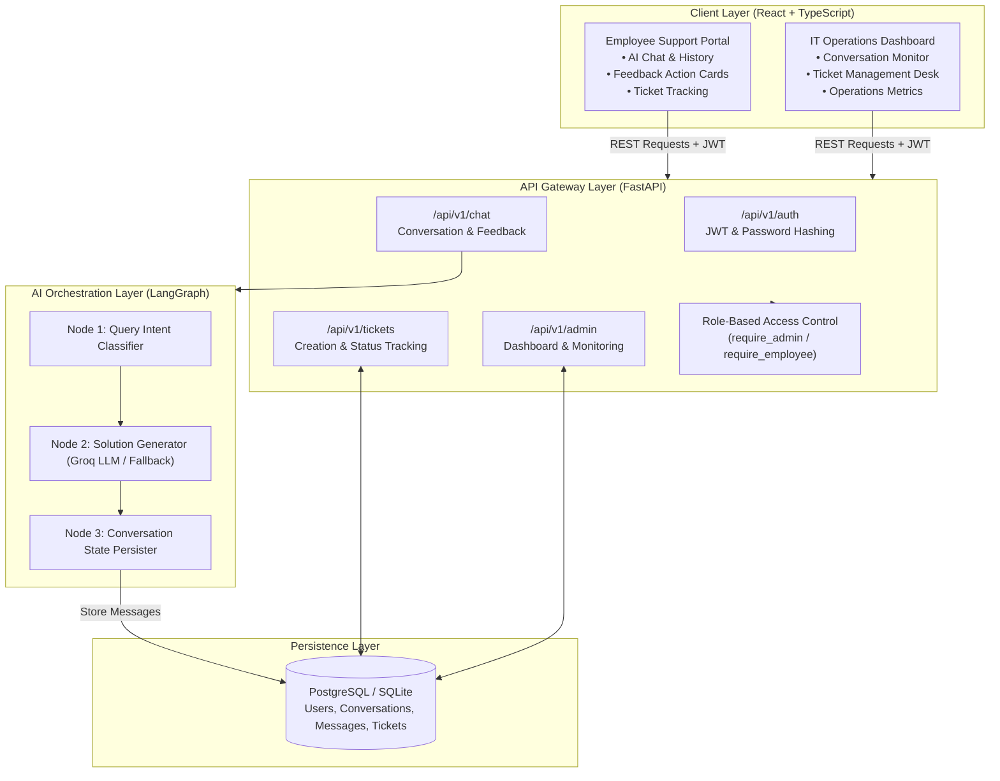
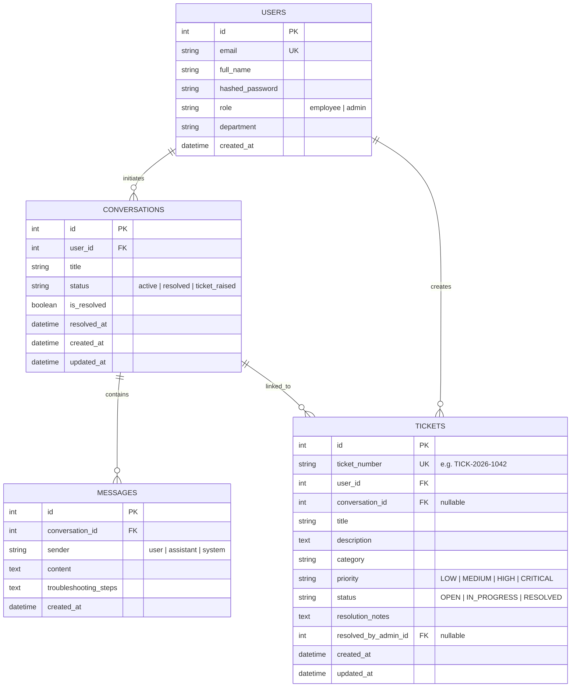
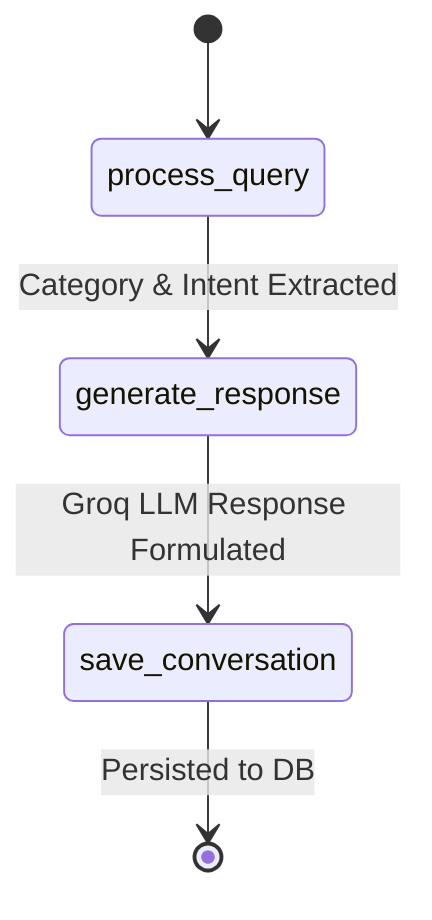

# AI-Powered IT Support Assistant & Operations Portal
## Comprehensive System Design & Workflow Architecture Document

---

## 1. Executive Summary & Core Objective

The **AI-Powered IT Support Assistant** is an internal corporate enterprise platform that automates Tier-1 IT support using **Groq LLM** orchestrated with **LangGraph**, and seamlessly escalates unresolved issues to human IT specialists via an integrated ticket management system.

### Primary Objectives:
1. **Reduce Tier-1 IT Ticket Volume**: Employees resolve common configuration, hardware, and access issues via instant, step-by-step guidance from Groq LLM.
2. **Context-Preserving Escalation**: When automated solutions fail, support tickets carry the entire conversation context (questions, attempted commands, and reasons for failure) to eliminate redundant back-and-forth communication.
3. **Operational Visibility**: IT administrators monitor live employee conversations and manage tickets across `OPEN`, `IN_PROGRESS`, and `RESOLVED` stages.

---

## 2. High-Level System Architecture

---

## 3. Core Component Architecture

### A. Frontend Layer (React 18 + Vite + Tailwind CSS)
- **Role-Based Views**: Dynamic rendering depending on JWT claims:
  - **Employee Persona**: Chat interface with past session history, step-by-step troubleshooting displays, action cards (*"Yes, problem solved"* vs *"No, problem still exists"*), and personal ticket tracking.
  - **IT Admin Persona**: Control center with metrics cards, real-time query monitoring, and ticket lifecycle management.
- **Context-Aware Modals**: Ticket creation forms automatically extract the conversation title and user query into editable fields.

### B. Backend API Gateway (FastAPI)
- **Security & RBAC**:
  - `python-jose` for JWT creation and decoding.
  - `passlib[bcrypt]` for cryptographic password hashing.
  - Dependency-injected authorization guards (`require_admin`, `get_current_user`).
- **Resilient Database Layer**: Configured for PostgreSQL with automatic zero-configuration fallback to SQLite for local development.

### C. AI Workflow Engine (LangGraph + Groq LLM)
A single stateful workflow graph (`StateGraph`) manages each conversation turn:
- **State Schema (`AgentState`)**: Holds query, user ID, conversation ID, chat history, detected category, generated solution, and ticket recommendation flags.
- **LLM Integration**: Uses Groq's OpenAI-compatible Chat Completions endpoint (`GROQ_BASE_URL=https://api.groq.com/openai/v1`, default model `llama-3.1-8b-instant`) with a category-aware offline fallback if no API key is configured.

---

## 4. Data Model & Entity Relationship (ER) Diagram

---

## 5. LangGraph State Machine Specification

| Node Name | Function | Input State Keys | Mutated / Output Keys |
|---|---|---|---|
| `process_query` | Extracts IT category keywords (Network, VPN, Outlook, Hardware, Software, Access) | `query` | `category` |
| `generate_response` | Calls Groq Chat Completions API (or category-aware fallback) for step-by-step troubleshooting | `query`, `category`, `history` | `response_content`, `troubleshooting_steps`, `suggest_ticket` |
| `save_conversation` | Saves assistant message to database and updates conversation title | `response_content`, `conversation_id` | `saved_message_id` |
